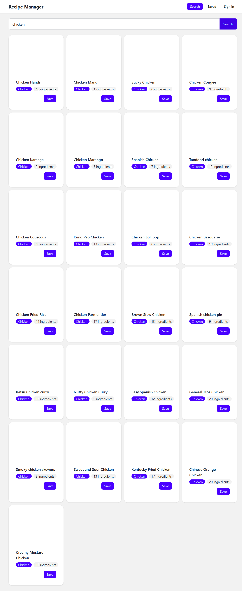

# Live demo: pending Vercel deployment



# Recipe Manager

A multi-page recipe app built with React, TypeScript, Vite, and React Router.
Search TheMealDB, save recipes in this browser, and protect the saved collection
behind a demonstration display-name sign-in.

The sign-in is **not real authentication**: there is no password or server-side
identity check. It demonstrates React context and protected routes only.
Recipes and the display name are stored in this browser's localStorage; they are
not shared between browsers or devices.

## Features

- Search TheMealDB and view recipe details at `/recipe/:mealId`.
- Save recipes, edit prep time and notes, toggle favorites, and delete recipes.
- Filter the saved collection by TheMealDB categories.
- Guard `/saved` behind a display-name sign-in.
- Cache API requests with TanStack Query.

## Run locally

Requirements: Node.js 20+ and internet access for TheMealDB.

```powershell
npm install
Copy-Item .env.example .env
npm run dev
```

Open the local URL printed by Vite. Saved recipes are stored in localStorage.
There is no JSON Server and no separate API terminal.

## Environment and deployment

`.env.example` contains the public TheMealDB base URL:

```env
VITE_MEALDB_URL=https://www.themealdb.com/api/json/v1/1
```

For Vercel, add `VITE_MEALDB_URL` to both Production and Preview environments,
then deploy or redeploy. Vite embeds `VITE_` variables in the JavaScript at
build time, so changing a value requires a new deployment; it is not a secret.
[`vercel.json`](./vercel.json) rewrites application routes to `index.html` so
deep links such as `/recipe/52772` work when opened or refreshed directly.

To check the production build locally:

```powershell
npm run build
npm run preview
```

## Data and routes

- `/` — search and save catalogue meals.
- `/login` — enter a display name.
- `/saved` — protected personal collection.
- `/recipe/:mealId` — full recipe detail.
- Other paths — in-app 404 page.

The recipe API functions keep the same async signatures while using
localStorage, so the existing React Query hooks and mutations do not depend on
the storage engine. Search results use `["meals", term]`, recipe details use
`["meal", mealId]`, categories use `["categories"]`, and the saved collection
uses `["recipes"]`.

## Tech stack

React 19 · TypeScript · Vite · React Router · TanStack Query · Axios · Tailwind
CSS · DaisyUI · TheMealDB
